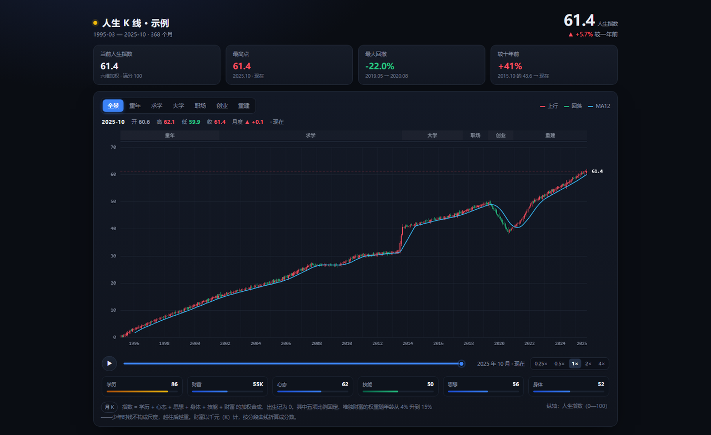
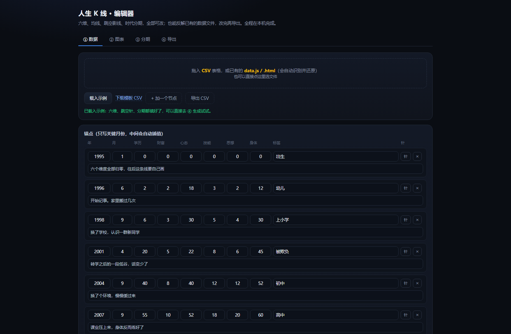

# 人生 K 线 · Life in Candlesticks

**把一段人生，画成一张 K 线图。**


学历、财富、心态、技能、思想、身体——六个维度加权成一个 **0—100 的人生指数**，出生记 0 分。  
此后每一次上涨、每一次崩盘，都落在具体的月份上。

红是往上，绿是往下。那根特别长的上影线，往往是一段「以为要成了」的日子；  
而最深的绿柱下面，通常还有一句没写进图里的话。



纯前端：无后端、无依赖、无网络请求，双击 HTML 就能看。

---

## 先看示例

打开 `index.html`，或直接开 `example.html`——一条虚构的、1995—2025 的完整人生曲线。  
拖动进度条可以回放：镜头只给你眼前四年，后面是涨是跌，得跟它一起等。

---

## 三步做出自己的

### 1. 填一张表

用 Excel / WPS 打开 `data/template.csv`：

```
年,月,学历,财富K,心态,技能,思想,身体,标签,事件,开,高,低
1995,3,0,0,0,0,0,0,出生,"六个维度全部为 0，从这里开始",,
2001,9,15,1,14,3,2,45,入学,"上小学",,
2020,8,78,3,22,34,36,42,失败,"留了长下影",24,27,12
```

- **不用逐月填**。只写关键节点，中间月份会自动插值。
- 六个分数都是 `0—100`，出生那一行全部写 `0`。
- `财富K` 的单位是**千元**：7.5 万就写 `75`。也可以在编辑器里把它当成 0—100 的分来用。
- `标签` 是图上那个金色小标签，2—4 个字最好看，可以留空。
- `事件` 是鼠标悬停和播放字幕里显示的说明。
- `开 / 高 / 低` **可以不填**（自动生成）。填了就用你给的值——想做一根超长上影线、
  或者一个跳空缺口，就在这三格写数，其余留空也行。

### 2. 编辑与生成

把 CSV 拖进 `csv2js.html`。它是一个编辑器，分四页：

| 页 | 能改什么 |
|---|---|
| ① 数据 | 每个节点的年、月、六维、标签、事件、跳空针（开/高/低）；可加行、删行、导出 CSV |
| ② 图表 | 标题、财富列含义、**MA 周期**、**EMA 周期**、副图开关、起止年月 |
| ③ 分期 | 按学段自动分 / 均分四段 / 手动增删 |
| ④ 导出 | 生成、预览、保存并覆盖文件 |



不想用 Excel 也行：直接在 ① 里加行填数，或者点「载入示例」先照着一份改。

> Excel 存出来的中文 CSV 通常是 GBK 编码，工具会自动识别，不用手动转。

### 3. 保存

点「预览图表」先在新标签页看一眼，满意后点 **「保存并覆盖文件」**。

第一次会弹出系统保存窗口：导航到你项目的 `data` 文件夹，文件名保持 `example.js`，
点保存，系统问「已存在，要替换吗」选替换即可。

之后这个页面会记住这个位置（存在浏览器里），**再点一下就直接覆盖**，不用再选。

如果浏览器不支持（Safari、部分老版本），会退化成普通下载，文件名可能被加 `(1)`，那就需要手动替换。

---

## 反解：把已有的图还原成数据

手上只有一个 `data/*.js`，或者一份早就生成好的 `.html`，想改点什么？

把它拖进 `csv2js.html` 就行。编辑器会从里面找出 `window.KLINE_DATA`，**还原成可编辑的表格**：

- 每个节点的六个分数、标签、事件
- 手写过的开盘 / 最高 / 最低（那些超长影线）
- 标题、财富列含义、MA / EMA 周期、副图开关
- 时代分期的名字和年月

改完点「生成」再「保存并覆盖」，或者点「导出 CSV」拿去 Excel 里继续弄。

因为是完整的往返，所以不用担心丢东西：反解 → 修改 → 生成，出来的数据和原来等价。

---

## 直接改 JS 也行

`data/example.js` 就是纯数据，会一点代码可以直接改：

```js
window.KLINE_DATA = {
  title: "我的人生 K 线",

  y0: 1995, m0: 3,          // 起点年月
  lastY: 2025, lastM: 10,   // 终点年月

  // 图表顶部的时代分期，同时决定上面的切换按钮
  stages: [
    { key:"s0", name:"童年", from:[1995,3], to:[2001,8] },
    { key:"s1", name:"求学", from:[2001,9], to:[2013,8] }
  ],

  // 关键节点：[年, 月, 学历, 财富K, 心态, 技能, 思想, 身体, "标签", "事件"]
  anchors: [
    [1995, 3, 0, 0, 0, 0, 0, 0, "出生", "……"],
    [2001, 9, 15, 1, 14, 3, 2, 45, "入学", "……"]
  ]
};
```

### 想让某个月长成一根针

在锚点后面加第 11 项，手动指定开盘 / 最高 / 最低：

```js
[2019, 7, 78, 28, 38, 26, 32, 48, "冲高", "……", {o: 39.8, h: 54.5, l: 38.6}]
```

含义是：这个月一路冲到 54.5，最后收在 43 附近。下一根再接一根大阴线，  
就是「冲高—插针—断崖」的形态。

---

## 指数是怎么算的

```
指数 = 学历×w1 + 心态×w2 + 思想×w3 + 身体×w4 + 技能×w5 + 财富×w6
```

- 前五项比例固定：学历 22%、心态 22%、思想 15%、身体 15%、技能 13%（合计 87%）。
- **财富的权重随年龄递增**：5 岁时 4%，22 岁时 15%；其余五项按比例分摊剩下的权重。

为什么要这样设计？因为 **小时候不需要多少钱就很开心**。  
如果财富一上来就占 13%，一个孩子的曲线会被几百块压岁钱拖得一塌糊涂。

### 六个维度怎么打分

| 维度 | 含义             | 参考区间                                      |
| -- | -------------- | ----------------------------------------- |
| 学历 | 学段进度           | 学前 0；小学 15—30；中学 30—55；本科 60—78；研究生 85—90 |
| 财富 | 可支配资产（千元）      | 写金额即可，程序按分段曲线折算成 0—100                    |
| 心态 | 心理韧性，**不是**快乐值 | 受挫会掉，但恢复后通常比之前更高                          |
| 技能 | 语言、专业、动手能力     | 缓慢累积，很少倒退                                 |
| 思想 | 认知深度           | 缓慢累积，重大转折才会跳                              |
| 身体 | 体能状态           | 最容易大起大落，按真实情况给分                           |

分数不是绝对标准，只要**同一个人前后一致**，曲线就有意义。

---

## 交互

- **▶ / 拖动进度条**：回放。镜头只显示最近四年，右侧留白——看不到后面是涨是跌。
- **鼠标悬停**：显示当月六维分值、开高低收，以及那天发生了什么。
- **顶部按钮**：切到某个时代分期，自动放大。

---

## 文件结构

```
.
├── index.html          入口
├── example.html        图表面板
├── csv2js.html         CSV → 数据文件
├── assets/
│   ├── style.css
│   └── engine.js       渲染引擎（一般不用动）
└── data/
    ├── example.js      数据（只改这个）
    └── template.csv    Excel 模板
```

---

## 常见问题

**图表一片空白？**  
打开浏览器控制台看报错。最常见的原因是数据文件里数组格式坏了——少了逗号，或者中英文引号混用  
（必须是英文 `"`）。

**曲线几乎是一条直线？**  
相邻两个节点间隔太长、分数跨度又小。中间加几个节点（哪怕分数不变），曲线就会有起伏。

**想加维度 / 改权重？**  
改 `assets/engine.js` 里的 `DIMS`、`W`、`weaScore()` 三处，注意权重总和恒为 1。

**能部署到网上吗？**  
能，全是静态文件，扔到 GitHub Pages / Vercel / 任意静态托管即可。

---

## License

MIT。见LICENSE
